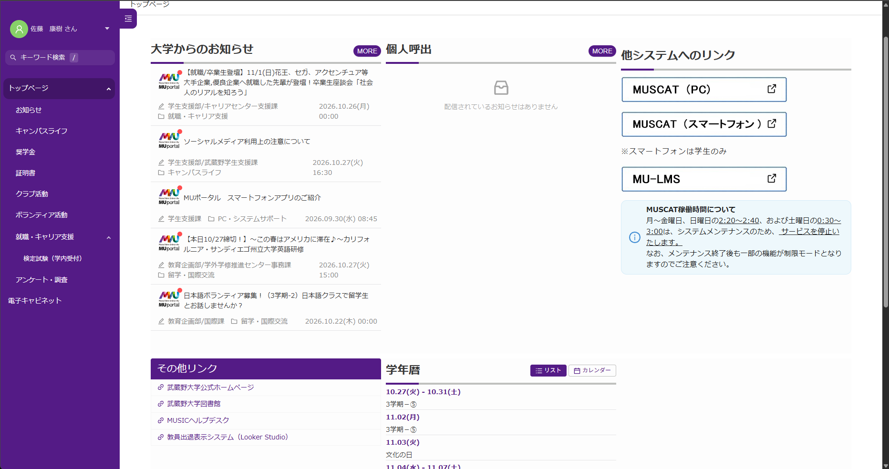
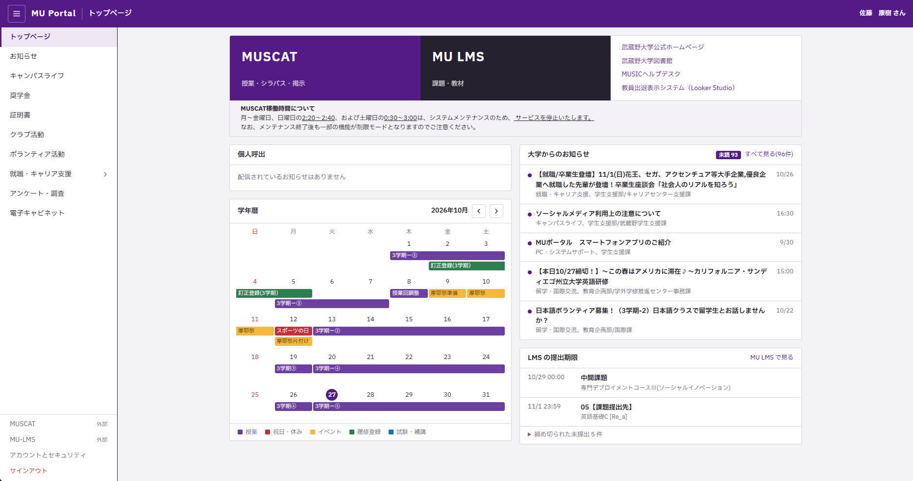
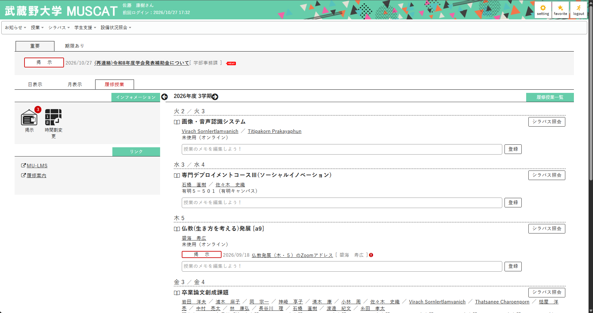
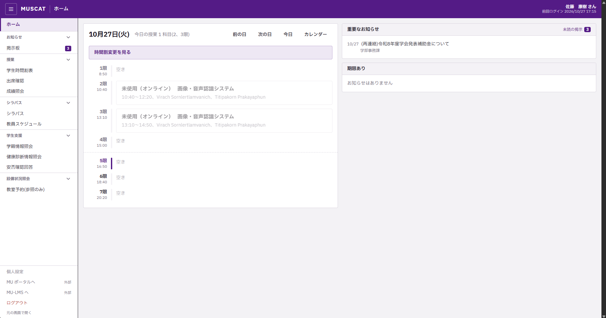
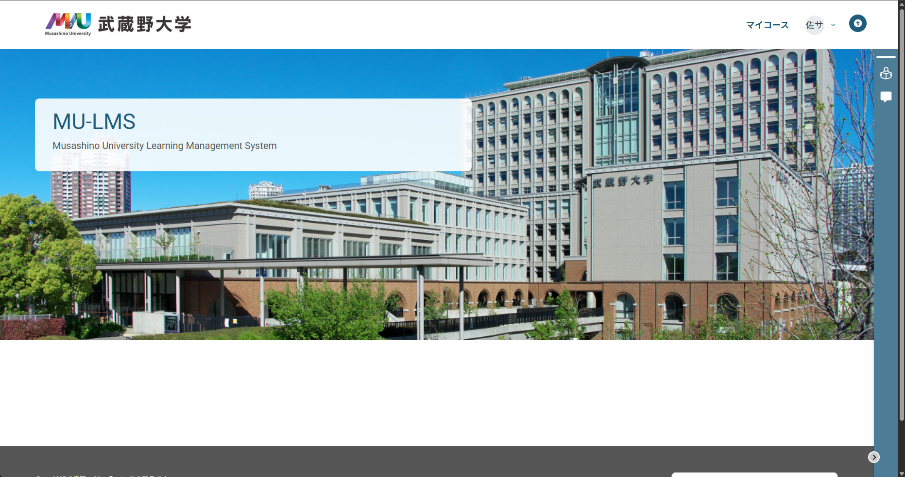
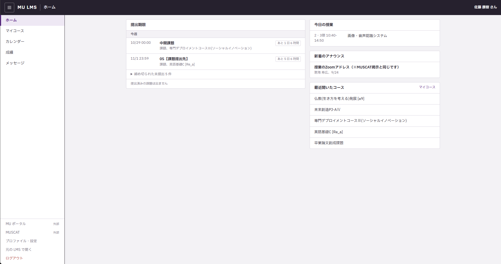

# MU Portal Rewrite

武蔵野大学の **MUSCAT・MU ポータル・MU-LMS** を、見やすく軽い画面に置き換える Chrome 拡張です。

- **MUSCAT**(`unipa.m-muscat.musashino-u.ac.jp`): 時間割・成績・出欠・シラバス検索・お知らせなどを新しい画面で表示します。再読み込みしてもエラー画面にならず、元の画面に戻ります。
- **MU ポータル**(`portal.musashino-u.ac.jp`): トップページ・お知らせ・キャビネット・学年暦を置き換えます。
- **MU-LMS**(`musashino-u.myopenlms.net`): コース・課題と提出・カレンダー・成績・フォーラム・メッセージを置き換えます。PDF は画面内でプレビューできます。

大学の非公式ツールです。表示を置き換えるだけで、送る内容は元のサイトと同じです。

## 主な改善

### MU ポータル

- 画面を作り直して見やすく
- ポータルでLMSの提出状況の確認が出来るように
- RIP MobileMUSCAT👋

| Before | After |
|---|---|
|  |  |

### MUSCAT

- 再読み込みしてもエラー画面やログイン画面が出ない
- 画面の読み込みを速く

| Before | After |
|---|---|
|  |  |

### MU-LMS

- 自動 SSO ログイン
- ホームに締め切り・新着のお知らせ・最近のコースを表示
- マイコースを MUSCAT の時間割と同じ形で表示(学期の切り替え、「すべて」も可)
- コースページは全セクションを一度に表示、折りたたみ可
- 課題ページから直接ファイル・テキストを提出(Moodle が受け付けたときだけ「提出済み」と表示)
- PDF はダウンロードせずにその場でプレビュー
- 月カレンダー・成績・お知らせ・メッセージ・通知・動画・検索
- 期限切れで閉じた課題は件数にまとめて表示

| Before | After |
|---|---|
|  |  |

## インストール

Chrome ウェブストアから「Chrome に追加」を押してインストールします。あとは各サイトを開くだけで新しい画面になります。

更新はウェブストアから自動で入ります。

## プライバシー

[プライバシーポリシー](docs/privacy.md)を見てください。

## 設定

拡張のアイコンから開きます。

- **表示の大きさ**: 小・標準・大・特大。3 つのサイトすべてに効き、開いている画面もすぐ変わります。

## ご意見・不具合報告

[フォーム](https://forms.gle/TVVn6zRAQDT8tqUX8)から送ってください(拡張のアイコンからも開けます)。そのときバージョン(アイコンの画面に表示)も書いてください。

## 開発

[docs/development.md](docs/development.md) を見てください。
